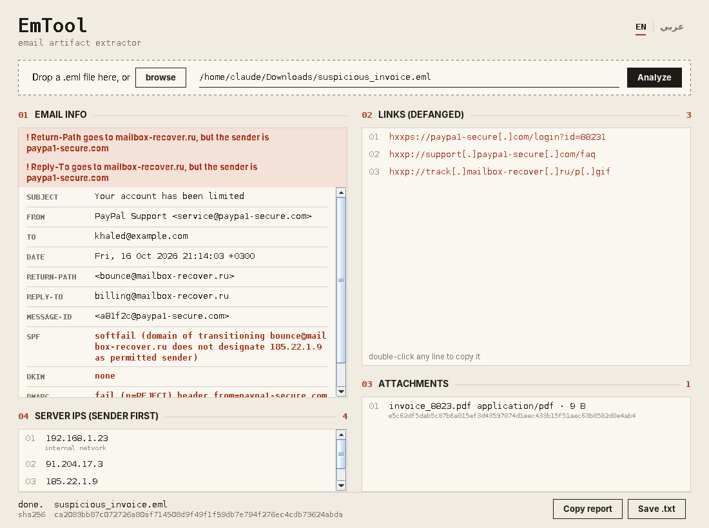
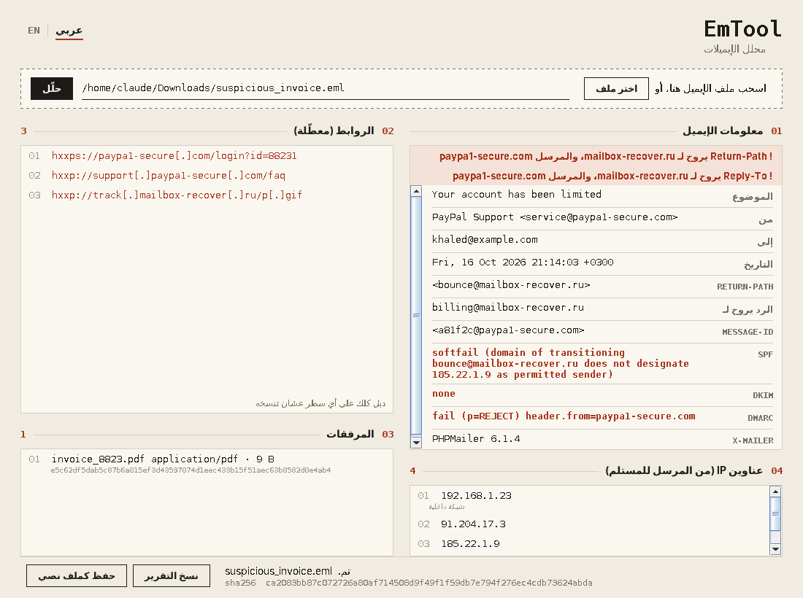

# EmTool · محلل الإيميلات

Reads an `.eml` file and pulls out the artifacts an analyst needs: the key headers, every link (defanged so nobody clicks it by accident), and the attachment names. Runs locally, nothing is sent anywhere.

يقرأ ملف الإيميل `.eml` ويطلع لك الأدلة اللي تحتاجها في التحليل: أهم الترويسات، كل الروابط (معطّلة عشان ما أحد يضغطها بالغلط)، وأسماء المرفقات. يشتغل على جهازك بس، وما يرسل شي لأي مكان.



## What it shows

| Section | What you get |
|---|---|
| Email info | Subject, From, To, Date, Return-Path, Reply-To, Message-ID, X-Mailer, and the SPF, DKIM and DMARC results (pass in green, fail in red) |
| Warning | Shown when Return-Path or Reply-To points to a different domain than the sender, a common phishing sign |
| Links | Every `http(s)` URL from the plain-text and HTML body, de-duplicated and defanged (`hxxps://site[.]com`) |
| Attachments | Name, type, size and SHA-256 of each attachment, ready to paste into VirusTotal |
| Server IPs | IPs from the `Received` headers, from the sender's side to yours; private ranges are marked |
| Footer | SHA-256 of the `.eml` file |

Then copy the whole report or save it as a `.txt`. Double-click any line (a link, a hash, an IP) to copy it.

The interface switches between English and Arabic from the `EN | عربي` toggle at the top; in Arabic the layout flips right-to-left while addresses and links stay left-to-right.

## Run it

You need Java 8 or newer. From inside the `EmAnalizeTool` folder:

**Windows**
```
javac -cp ".;lib/*" -encoding UTF-8 *.java
java -cp ".;lib/*" EmToolGUI
```

**macOS / Linux**
```
javac -cp ".:lib/*" -encoding UTF-8 *.java
java -cp ".:lib/*" EmToolGUI
```

Compile once; after that the `java` line is enough. Drop an `.eml` file on the window, paste its path, or press **browse**. You can also pass the path directly: `java -cp ".;lib/*" EmToolGUI path\to\mail.eml`.

The original terminal version is still there: `java -cp ".;lib/*" EmTool`.

### Font

The window uses the Thmanyah font when it can find it. Download it from Thmanyah's official font page, then either install it on your system or put the `.ttf`/`.otf` files in `EmAnalizeTool/fonts/`. Without it the tool falls back to the system font. The font files are not included in this repo because Thmanyah's license does not allow redistributing them.

## Why javax.mail and not plain text

`javax.mail` parses the email format directly (MIME parts, encodings, attachments). Reading the file as plain text would mean re-implementing all of that by hand.

## Files

```
EmAnalizeTool/
  EmTool.java          original command-line tool
  EmailAnalyzer.java   parsing used by the GUI
  EmToolGUI.java       the desktop window
  lib/                 javax.mail + javax.activation
```

---

## بالعربي

### وش يسوي
- يطلع معلومات الإيميل: الموضوع، المرسل، المستلم، التاريخ، Return-Path، Reply-To، Message-ID، X-Mailer، ونتيجة SPF و DKIM و DMARC (الأخضر pass، والأحمر fail)
- ينبهك لو Return-Path أو Reply-To يروح لدومين غير دومين المرسل، وهذي علامة تصيد معروفة
- يطلع كل الروابط من نص الإيميل ومن الـ HTML، بدون تكرار، ومعطّلة بهالشكل `hxxps://site[.]com`
- يعرض المرفقات: الاسم والنوع والحجم و SHA-256، تحطه في VirusTotal على طول
- يطلع عناوين IP من ترويسات Received، من جهة المرسل لين توصلك، والداخلية عليها علامة
- يحسب SHA-256 لملف الإيميل نفسه
- تقدر تنسخ التقرير كامل أو تحفظه كملف نصي، ودبل كلك على أي سطر (رابط، هاش، IP) ينسخه

الواجهة فيها عربي وإنجليزي من الزر اللي فوق `EN | عربي`، وبالعربي الواجهة تنقلب من اليمين لليسار.



### طريقة التشغيل
تحتاج Java 8 أو أحدث. افتح التيرمنل داخل فولدر `EmAnalizeTool`:

```
javac -cp ".;lib/*" -encoding UTF-8 *.java
java -cp ".;lib/*" EmToolGUI
```

أمر `javac` تسويه أول مرة بس. على ماك أو لينكس بدّل `;` بـ `:`.
بعدها اسحب ملف الإيميل على النافذة، أو الصق مساره، أو اضغط **اختر ملف**.

النسخة القديمة اللي تشتغل بالتيرمنل باقية: `java -cp ".;lib/*" EmTool`

### الخط
الأداة تستخدم خط ثمانية إذا لقته. نزّله من صفحة الخط الرسمية حقت ثمانية، وبعدها يا تثبته على جهازك، يا تحط ملفات `.ttf` أو `.otf` داخل فولدر `EmAnalizeTool/fonts/`. إذا ما لقته تشتغل بخط النظام. ملفات الخط مو موجودة في الريبو لأن رخصة ثمانية ما تسمح بإعادة نشرها.

### ليش javax.mail وما خليته txt
- مكتبة javax.mail جاهزة وتتعامل مع الإيميلات مباشرة (الأجزاء، الترميز، المرفقات)
- لو قريته كـ txt بتحتاج تعالج كل هذا بنفسك
