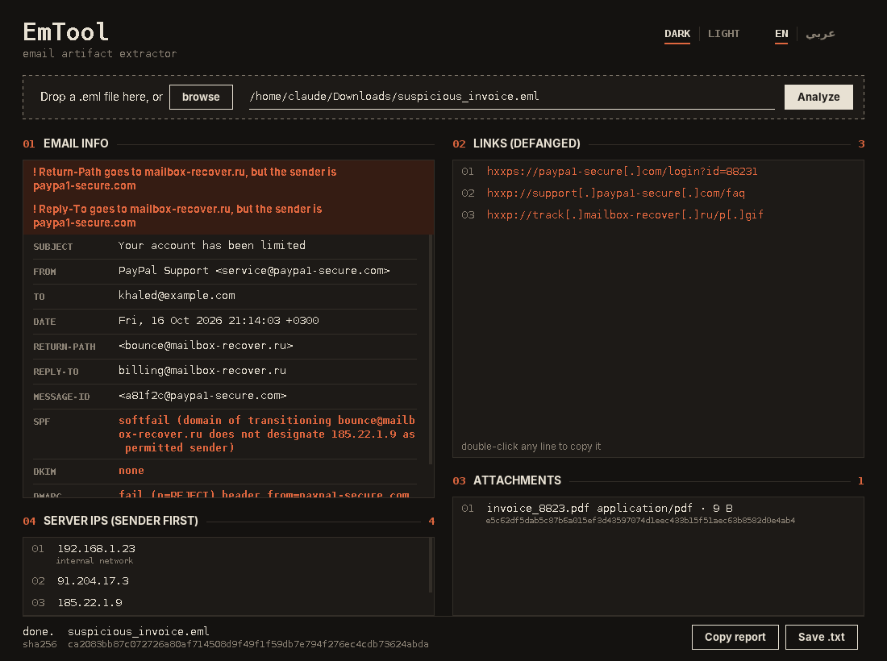
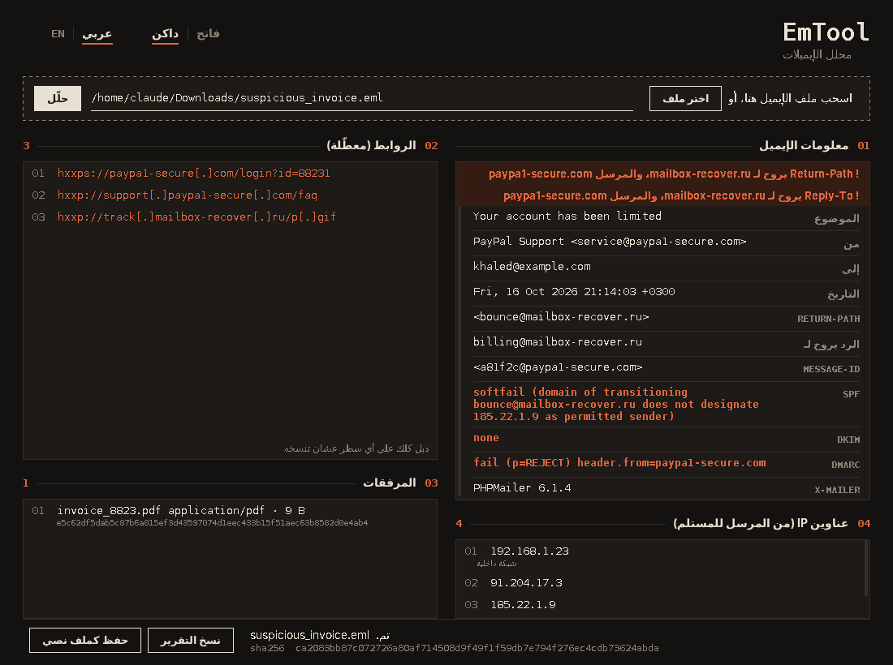

<h1 align="center">EmTool</h1>

<p align="center">
  Email artifact extractor for phishing triage<br>
  <a href="#بالعربي">العربية</a> · <a href="#english">English</a>
</p>

<p align="center">
  
  
  
  
</p>

<picture>
  <source media="(prefers-color-scheme: dark)" srcset="docs/screenshot-en-dark.png">
  <source media="(prefers-color-scheme: light)" srcset="docs/screenshot-en-light.png">
  
</picture>

---

<div dir="rtl">

## بالعربي

تفتح الإيميل المشبوه بدون ما تفتحه فعلياً. تعطي الأداة ملف `.eml` وتطلع لك كل شي يهمك في التحليل في شاشة وحدة: مين أرسله ومن وين جا، وش فيه روابط، وش فيه مرفقات، وهل اجتاز فحص SPF و DKIM و DMARC. كل شي يصير على جهازك، وما يطلع أي شي للنت.

### وش تطلع لك

| القسم | المحتوى |
|---|---|
| معلومات الإيميل | الموضوع، المرسل، المستلم، التاريخ، Return-Path، Reply-To، Message-ID، X-Mailer |
| فحص المرسل | نتيجة SPF و DKIM و DMARC، الأخضر نجح والأحمر فشل |
| تنبيه | إذا Return-Path أو Reply-To يروح لدومين غير دومين المرسل، وهذي من أوضح علامات التصيد |
| الروابط | كل الروابط من نص الإيميل ومن الـ HTML، بدون تكرار، ومعطّلة عشان ما تنفتح بالغلط: `hxxps://site[.]com` |
| المرفقات | الاسم والنوع والحجم و SHA-256، جاهز تحطه في VirusTotal |
| عناوين IP | من ترويسات Received، مرتبة من جهة المرسل لين وصلت لك، والداخلية عليها علامة |

دبل كلك على أي سطر ينسخه، وتقدر تنسخ التقرير كامل أو تحفظه كملف نصي. الواجهة داكنة افتراضياً وفيها وضع فاتح، وتتحول بين العربي والإنجليزي من فوق.

<picture>
  <source media="(prefers-color-scheme: dark)" srcset="docs/screenshot-ar-dark.png">
  <source media="(prefers-color-scheme: light)" srcset="docs/screenshot-ar-light.png">
  
</picture>

### التشغيل

تحتاج Java 8 أو أحدث. افتح التيرمنل داخل فولدر `EmAnalizeTool`:

</div>

```
javac -cp ".;lib/*" -encoding UTF-8 *.java
java  -cp ".;lib/*" EmToolGUI
```

<div dir="rtl">

أمر `javac` مرة وحدة بس. على ماك أو لينكس بدّل `;` بـ `:`. بعدها اسحب الإيميل على النافذة أو اضغط **اختر ملف**.
النسخة الأصلية اللي تشتغل بالتيرمنل موجودة زي ما هي: `java -cp ".;lib/*" EmTool`

### الخط

الأداة مصممة على خط ثمانية. نزّله من صفحة الخط الرسمية حقت ثمانية، وثبّته على جهازك أو حط ملفاته في `EmAnalizeTool/fonts/`، والأداة تلقاه بنفسها. إذا ما لقته تشتغل بخط النظام. ملفات الخط مو في الريبو لأن رخصتها ما تسمح بإعادة النشر.

### ليش javax.mail

الإيميل مو نص عادي: فيه أجزاء متداخلة وترميزات ومرفقات. `javax.mail` يفك هذا كله مباشرة، ولو قريناه كـ txt كان لازم نكتب كل هالمعالجة بأيدينا.

</div>

---

## English

Open a suspicious email without actually opening it. Give EmTool an `.eml` file and it lays out everything that matters for triage on one screen: who sent it and through which servers, every link, every attachment, and whether it passed SPF, DKIM and DMARC. Everything runs locally; nothing leaves your machine.

### What it extracts

| Section | Content |
|---|---|
| Email info | Subject, From, To, Date, Return-Path, Reply-To, Message-ID, X-Mailer |
| Sender checks | SPF, DKIM and DMARC results, green on pass and red on fail |
| Warning | Raised when Return-Path or Reply-To points to a different domain than the sender, a classic phishing sign |
| Links | Every URL in the plain-text and HTML body, de-duplicated and defanged so it can't be clicked by accident: `hxxps://site[.]com` |
| Attachments | Name, type, size and SHA-256, ready for VirusTotal |
| Server IPs | Parsed from the `Received` chain, ordered from the sender's side to yours, private ranges marked |

Double-click any line to copy it, or copy and save the full report as text. Dark theme by default with a light option, and an English / Arabic switch in the top bar.

### Run

Java 8 or newer. From inside the `EmAnalizeTool` folder:

```
# Windows
javac -cp ".;lib/*" -encoding UTF-8 *.java
java  -cp ".;lib/*" EmToolGUI

# macOS / Linux
javac -cp ".:lib/*" -encoding UTF-8 *.java
java  -cp ".:lib/*" EmToolGUI
```

Compile once. Then drop an email on the window, paste its path, or press **browse**. A path can also be passed directly: `java -cp ".;lib/*" EmToolGUI mail.eml`.
The original command-line tool is unchanged: `java -cp ".;lib/*" EmTool`.

### Font

The interface is designed around the Thmanyah typeface. Download it from Thmanyah's official font page, then install it or drop the `.ttf` / `.otf` files into `EmAnalizeTool/fonts/`; EmTool picks it up automatically and falls back to the system font otherwise. The font files are not bundled because their license does not permit redistribution.

### How it works

```
.eml ──> javax.mail MimeMessage
          ├─ headers ─────────> email info, SPF / DKIM / DMARC, domain check
          ├─ Received chain ──> server IPs (reversed: sender first)
          └─ MIME tree
               ├─ text/plain, text/html ──> URL regex ──> defang
               └─ named parts ────────────> name, type, size, SHA-256
```

### Project layout

```
EmAnalizeTool/
  EmTool.java          original command-line tool
  EmailAnalyzer.java   parsing behind the GUI
  EmToolGUI.java       desktop window
  lib/                 javax.mail, javax.activation
docs/                  screenshots
```
